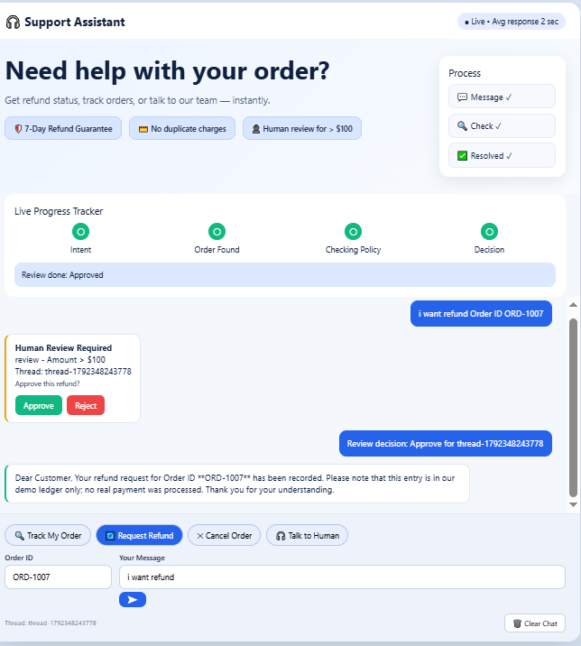
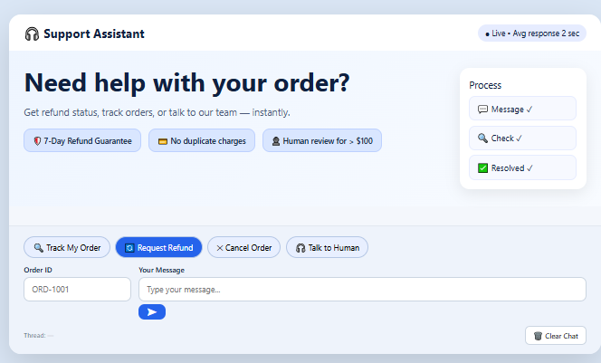
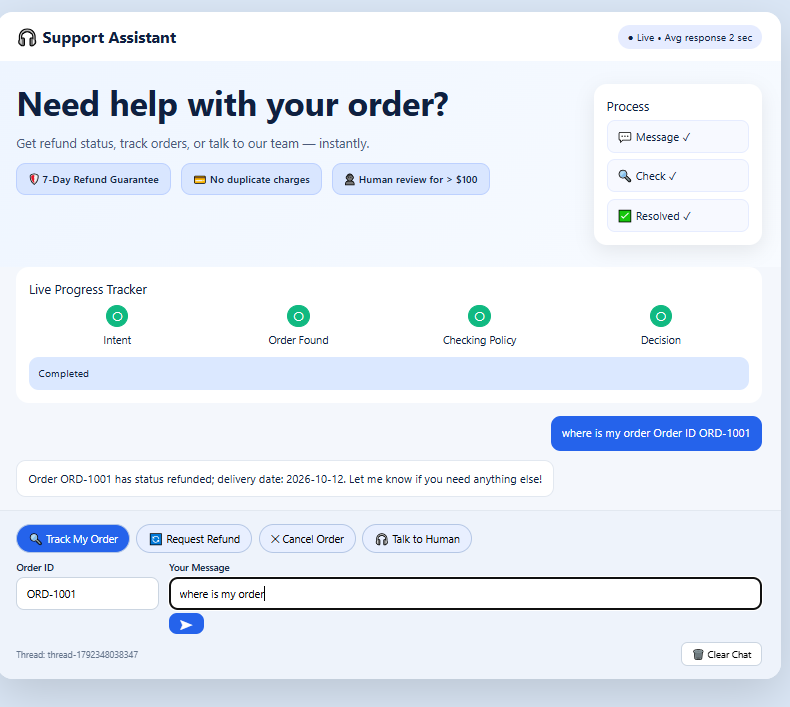
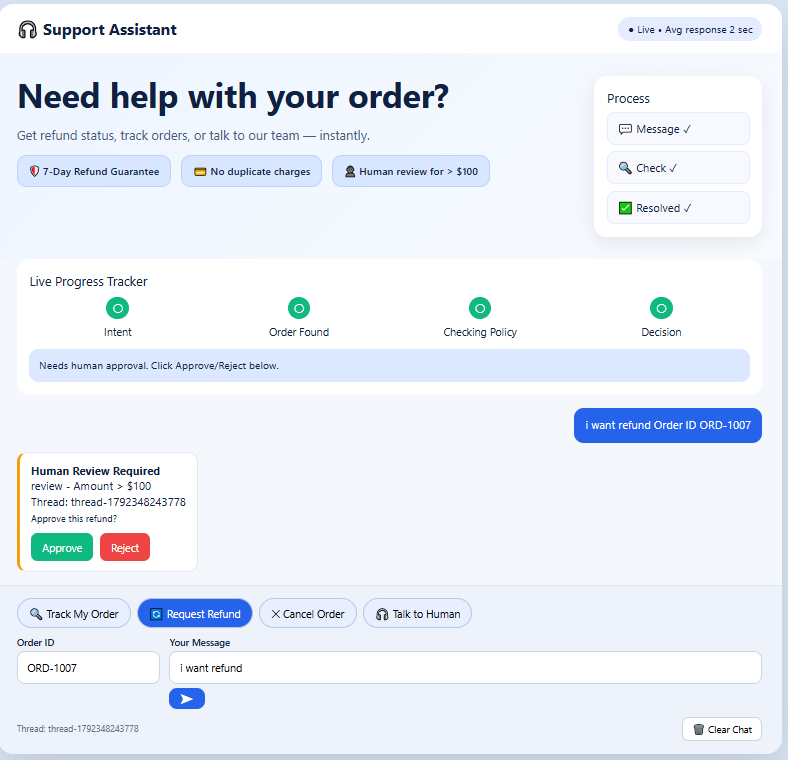

# LangGraph Customer Support & Refund Agent — CSV Edition

> Agentic support bot built with **LangGraph + Groq + FastAPI** + Vanilla JS UI. No SQLite — uses `data/orders.csv` for orders and `data/refunds.csv` for a demo refund ledger.
>
> ### Windows PowerShell Setup

```powershell
py -3.11 -m venv venv
.\venv\Scripts\Activate.ps1
pip install -r requirements.txt
Copy-Item .env.example .env
```

Edit `.env` and set `GROQ_API_KEY`. Run:

```powershell
uvicorn main:app --reload
```

Open http://127.0.0.1:8000/docs.

## Examples

POST `/support`:

```json
{"thread_id":"demo-1","message":"Please refund ORD-1002"}
```

`ORD-1002` costs $120 and triggers human approval. Resume by POSTing to `/review/demo-1`:

```json
{"approved":true}
```

Other scenarios: `ORD-1001` ($75, auto-approved); `ORD-1003` ($350, human review); `ORD-1004` (expired refund window); `ORD-1005` (already refunded). Use a new `thread_id` per request.

## Data files

On first server startup, the project automatically creates 20 demo orders in `data/orders.csv` and an empty `data/refunds.csv`. Subsequent startups preserve edits and refunds. To reset, stop the server, delete the two CSV files, and restart.

## Important limitations

- LangGraph uses `InMemorySaver` for checkpoints: **pending approvals are lost on server restart**. CSV data remains.
- CSV writes are protected by a Python thread lock only within a single process. Run one server worker; do not edit the CSV while the server is running.
- CSV storage is educational and is **not transactional** across multiple files. A crash between writing the refund ledger and updating the order may leave inconsistent records, though the ledger helps block duplicate refunds.
- The demo only records refunds locally. No real payments are made.
- The review endpoint has no authentication; add it before any deployment.

**What it does:** Classifies user intent → looks up order from CSV → checks refund policy → auto-refunds (<$100) / asks for human approval (>$100) / gives tracking info. No real payments, only local ledger.



### Live Demo Features
- **Live Progress Tracker:** Intent → Order Found → Checking Policy → Decision → Completed
- **Clear Chat:** Resets UI thread + `thread_id`
- **3 Policy Paths:**
    - `ORD-1001` ($75) → Auto-approved refund
    - `ORD-1002 / ORD-1003 / ORD-1007` (>$100) → Human Review with Approve/Reject buttons
    - Tracking / Cancel / Complaint → Information-only, no hallucination
- **Anti-hallucination Fix:** `compose_reply()` returns policy `detail` directly for `information_only`

### Architecture
User: message + order_id + thread_id
        ↓
graph.py: classify_node → lookup_node → policy_node
        ↓
   ┌─────────────┬──────────────┬─────────────────┐
   refund_node  human_node   non_refund_node
   (<$100)      (>$100)      (tracking/cancel)
   └─────────────┴──────────────┴─────────────────┘
                      ↓
               reply_node (agents.py)


### Demo Screenshots

**1. Main UI**


**2. Tracking Flow - ORD-1001**

> "where is my order ORD-1001" → Returns `status` + `delivery_date` from CSV

**3. Human Review Flow - ORD-1007**


> ORD-1007 ($120) triggers `Amount > $100` → Shows Approve/Reject card → After Approve, `Review done. Approved` + entry in `refunds.csv`


